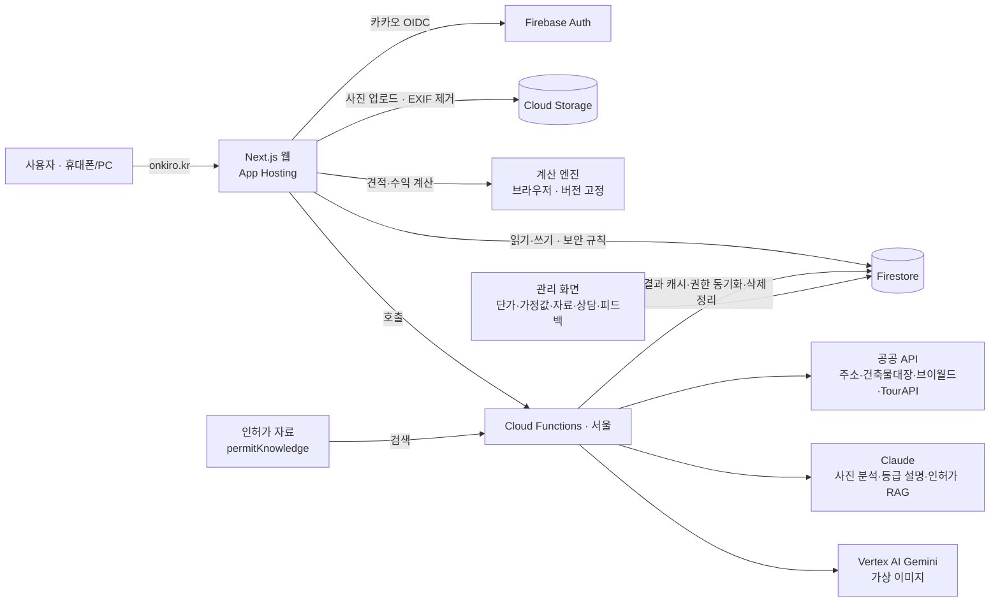

# 온기로 (ONKIRO) — AI 빈집 재생 시뮬레이터

> 주소 한 줄과 사진으로 농촌 빈집의 **공정별 공사비**와 **숙소 운영 수익**을 근거와 함께 계산하고, 현장진단·턴키 리모델링·위탁 운영 상담으로 연결하는 웹 서비스

- **서비스 주소**: https://onkiro.kr
- **팀**: 온기로 (코디세이 AI 네이티브 Final-Project)
- **지역**: 충남 홍성 (직영 1호점 운영 중)

## 1. 해결하려는 문제

| 대상 | 문제 |
| --- | --- |
| 귀촌·창업 희망자 | 빈집을 사도/빌려도 될지 판단할 숫자가 없다. 공사비 폭탄과 공실이 두렵다 |
| 빈집 소유주·상속인 | 방치된 집을 어떻게 할지 모르고, 어디에 물어야 할지도 모른다 |
| 운영팀 | 직영점의 실제 공사비·운영 실적이 흩어져 있어 견적 정확도를 높일 근거가 쌓이지 않는다 |

지금은 현장을 여러 번 오가며 몇 주~몇 달이 걸리는 판단을, 온기로는 **몇 분 안에 근거가 붙은 숫자**로 보여준다.

## 2. 주요 기능

1. **주소 입력 → 공공데이터 자동 조회**: 도로명주소, 건축물대장(연면적·구조·사용승인일·주용도), 브이월드 토지 특성(용도지역·도로 접면), TourAPI 주변 관광지(20km)
2. **사진 업로드 → AI 사진 분석**: 부위별 사진(외관·지붕·욕실·주방 등)을 보고 상태 체크리스트 답을 제안 (멀티모달)
3. **공정별 견적**: 단가 DB·상태계수·판정표로 공정별 금액·범위·공기 계산, 실내 마감 하·중·상 등급 비교 + AI 등급 설명
4. **AI 리모델링 가상 이미지**: 사진을 등급별 리모델링 후 모습으로 생성
5. **AI 인허가 안내 (RAG)**: 인허가 자료에서 이 집에 맞는 자료를 찾아 근거를 붙여 안내 (법적 판정 아님)
6. **수익 시뮬레이션**: 보수·기준·낙관 3안의 월 순수익·투자 회수기간
7. **리포트·상담**: PDF 리포트, 현장진단·턴키·빈집 맡기기 상담 신청 → 관리 화면 칸반
8. **숙소**: 직영점 상세·예약 신청(신청형), 홈 사진 관리
9. **관리 화면**: 단가 DB·가정값 버전 관리(두 사람 확인), 인허가 문구·자료, 촬영 가이드, 상담·예약·피드백 처리, 회원 권한
10. **사용자 피드백**: `/feedback`에서 로그인 없이 의견 보내기 → 관리 화면에서 반영 상태 관리

## 3. 팀원 및 역할

팀장이 기획·설계와 개발을 총괄하고, 팀원은 각자 전문 분야의 모듈을 맡아 함께 개발했다.

| 이름 | 분야 | 담당 업무 (개발·기여) | 관련 화면·파일 |
| --- | --- | --- | --- |
| 장상민 (팀장·PM) | 개발 총괄 | 기획·설계, 계산 엔진, 공공 API·AI 연동(사진 분석·가상 이미지·인허가 RAG), 보안 규칙, 배포 | `web/src/lib/engine/`, `functions/` |
| 지석원 | 건축 | 체크리스트 판정표 모듈, 공정 단가 DB·상태계수 (D2·D4·D5) | 관리 화면 단가 DB, `lib/engine/checklist.ts` |
| 김원일 | 부동산개발 | 수익 검증 사례·가정값, 상담 단계·배정 규칙, 인허가 항목·자료 (D6·D7·D13) | `lib/engine/revenue.cases.test.ts`, `lib/consult/status.ts`, `/admin/permit-knowledge` |
| 김해순 | 공간기획 | 숙소 상세·예약 화면, 촬영 가이드, 공정 모듈 구성 (D3·D9·D12) | `app/(public)/stay/`, `/admin/photo-guides` |
| 이주연 | 화면 UI | 공통 UI 컴포넌트, 서비스 소개 홈, 반응형 점검, 글꼴·색 기준 | `components/ui/`, `components/home/` |

팀원별 산출물(D1~D13)과 마감은 [prd.md](./prd.md) 3.2절, 작업 기록은 [task.md](./task.md)에 있다.

## 4. 기술 스택과 선정 이유

| 영역 | 기술 | 선정 이유 |
| --- | --- | --- |
| 웹 | Next.js 16 (App Router, TypeScript) | 한 코드로 화면·서버 렌더링, 타입으로 계산 로직 안정성 확보 |
| 인증 | Firebase Auth + Identity Platform (카카오 OIDC) | 고령 사용자도 쓰는 카카오 로그인, 커스텀 클레임으로 역할·권한 |
| DB | Cloud Firestore (서울) | 스냅샷·버전 문서 구조에 잘 맞고, 보안 규칙으로 역할별 접근 제어 |
| 파일 | Cloud Storage | 진단 사진·가상 이미지, 규칙으로 본인·담당자만 접근 |
| 서버 | Cloud Functions 2세대 (서울) | 공공 API·AI 키를 숨기는 프록시, 트리거·결과 캐시 |
| 배포 | Firebase App Hosting + onkiro.kr | `main` 푸시 시 자동 배포, 1인 개발에 맞는 무운영 인프라 |
| AI | Claude (Opus 5.5·Sonnet 5.5), Vertex AI Gemini 2.5 Flash Image | 사진 이해·구조화 출력은 Claude, 사진 기반 이미지 편집은 Gemini |
| 공공데이터 | 도로명주소, 건축물대장, 브이월드, TourAPI | 주소만으로 집·땅 정보를 자동으로 채움 |
| 테스트 | Vitest, Firebase 규칙 테스트(에뮬레이터) | 계산·AI 응답 검사·보안 규칙을 자동 검증 |

## 5. 시스템 아키텍처



- 계산 엔진은 브라우저에서 돌아 결과가 즉시 나오고, 결과는 단가·가정값·공식 버전과 함께 **스냅샷**으로 저장되어 언제든 재현된다.
- 기준값(단가·가정값·판정표·인허가 자료)은 관리 화면에서 고치면 배포 없이 반영된다. 단가·가정값 적용은 두 사람 확인 원칙을 따른다.

## 6. 핵심 AI 활용

자세한 설계는 [docs/AI설계.md](./docs/AI설계.md).

| 필수 기술 요소 | 온기로에서 |
| --- | --- |
| **멀티모달 AI** | 사진 → 체크리스트 답 제안(Claude Opus), 사진 → 리모델링 가상 이미지(Gemini 이미지 편집) |
| **RAG** | 인허가 자료 검색(주제 태그 + 낱말 겹침) → Claude가 자료만 근거로 안내, 항목마다 근거 자료 id 검증 |
| **자동화 워크플로우** | 주소 하나로 주소 검색 → 건축물대장 → 토지 특성 → 주변 관광지 → 캐시 → 계산까지 자동 연결, Functions 트리거(권한 동기화, 진단 삭제 시 AI 결과 정리) |

AI 설계 원칙: **금액·판정은 버전이 붙은 기준값이 계산하고, AI는 제안·설명·참고 그림만 만든다.** 모든 AI 응답은 도구(JSON 스키마) 형식으로 받고 서버에서 다시 검사한다.

## 7. 실행 방법

### 요구사항
- Node.js 22 이상, npm
- (서버 함수·규칙 테스트) Firebase CLI — 루트에서 `npm install`로 함께 설치됨

### 설치와 실행

```bash
git clone https://github.com/smz7093-web/onkiro.git
cd onkiro
npm install                 # 규칙 테스트·에뮬레이터 도구
cd web && npm install       # 웹
npm run dev                 # http://localhost:3000
```

로컬 에뮬레이터(로그인·DB·파일)로 띄우려면 `web`에서 `npm run dev:emu`.

### 검사

```bash
# 웹 (web 폴더)
npm run lint && npm run typecheck && npm test
# 서버 함수 (functions 폴더)
npm install && npm test
# 보안 규칙 (루트, 에뮬레이터 자동 실행)
npm run test:rules
```

비밀 값(Anthropic 키, 공공 API 키)은 저장소에 없고 Secret Manager에 있다. 키가 없으면 AI·공공데이터 조회만 꺼지고 나머지는 동작한다.

## 8. 결과

- 배포: https://onkiro.kr (휴대폰·PC)
- 자동 테스트: 웹 147개, 서버 함수 99개, 보안 규칙 70개 (2026-10-26)
- 실제 데이터: 직영 1호점(홍성) 주소·사진으로 진단 → 견적 → 수익 → 리포트 → 상담 흐름 확인

## 9. 사용자 테스트 결과

- 기간: 2026-10-27 ~ 10-31 (예정) · 방법: onkiro.kr에서 진단을 직접 해 보고 `/feedback`으로 의견 제출
- 테스터: _N명 (빈집 소유주 _, 귀촌 희망 _, 관계자 _)_ · 평균 만족도 _ / 5 · 결과 신뢰도 _ / 5

| 받은 의견 | 반영한 내용 |
| --- | --- |
| _테스트 후 채움_ | _관리 화면 '사용자 피드백'의 반영 메모_ |

## 10. 문서

| 문서 | 내용 |
| --- | --- |
| [prd.md](./prd.md) | 제품 요구사항 (기능·비기능·데이터 모델·권한) |
| [MVP_기능명세서.md](./MVP_기능명세서.md) | 기능 요구 명세 |
| [시나리오.md](./시나리오.md) | 사용자 시나리오 |
| [docs/AI설계.md](./docs/AI설계.md) | AI 활용 설계 (프롬프트·RAG·모델 선택·윤리) |
| [task.md](./task.md) | 작업 목록·진행 기록 |
| [시연대본.md](./시연대본.md) | 시연 순서 |
| [CONTRIBUTING.md](./CONTRIBUTING.md) | 개발 참여 가이드 |

## 11. AI 윤리·개인정보

- AI 생성 결과에는 항상 "AI 가상 이미지", "AI가 … 쓴 참고 안내" 표시
- 개인정보 처리방침·이용약관 동의, AI 해외 전송은 별도 선택 동의(서버에서도 확인)
- 주소는 AI에 보내지 않고, 사진은 EXIF를 지운 뒤 저장, 보관 기간 후 삭제
- 견적은 추정치, 인허가는 법적 판정 아님을 화면마다 표시
